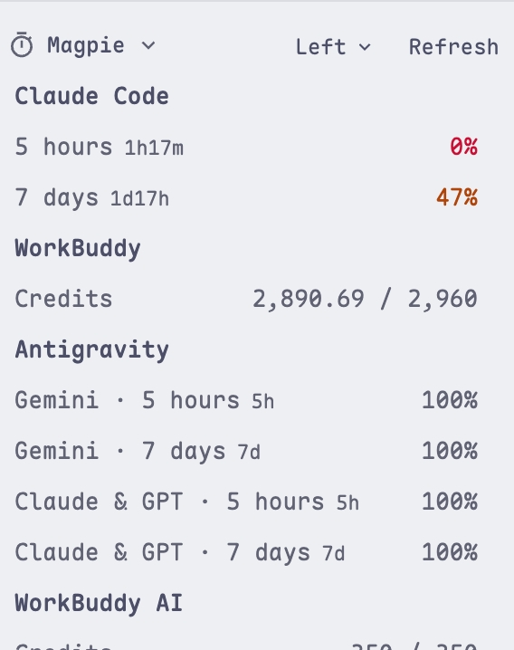
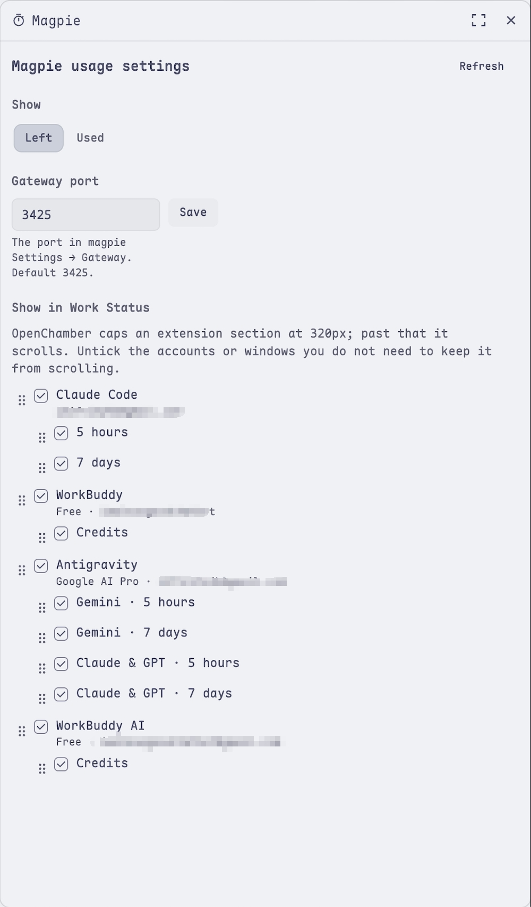

# Magpie · OpenChamber extension

[中文](README.md)

Shows how much of each [magpie](https://usemagpie.ai) subscription, coding plan and
API key is left, as plain text in the Work Status panel next to the chat. The layout
follows OpenChamber's own Usage section.

| Usage | Settings panel |
| --- | --- |
|  |  |

- The section header carries a *Left / Used* select and a Refresh button; ordering is
  dragged in the panel.
- Each account is a quiet sub-heading; under it one line per usage window with its name,
  a reset countdown and a right-aligned number. Half used turns the number amber, four
  fifths red, matching the built-in section.
- Resets read as a compact countdown: `2h7m`, `1d18h`, `5h`; hover shows the wall-clock
  time.
- Order comes from the panel's drag. Until something is dragged, windows are shortest
  first (5 hours before 7 days) and windows sharing a quota pool (Antigravity's Gemini,
  Claude & GPT) stay together.
- Windows a vendor counts rather than percentages show numbers: *left / total* in Left
  mode, *used / total* in Used mode, with the percentage in the tooltip.
- When the session runs a model magpie provides (like `magpie/claude/claude-opus-5-5`),
  that account leads.
- Reads again every 60 seconds and right after a turn ends. Balance accounts show the
  balance next to their heading; an account magpie cannot read shows *Could not read*
  with the reason on hover.
- Choices sync every 5 seconds: a change made in the panel reaches the section in at
  most 5 seconds.
- Text follows OpenChamber's language (Chinese or English); colours follow the theme.

## Panel

The rail panel is the settings panel — the usage itself lives in the Work Status
section next to the chat:

- **Show**: left or used.
- **Gateway port**: the port from magpie Settings → Gateway.
- **Show in Work Status**: a checkbox per account and per window, with a grip on the
  left to drag them into order.

Dragging an account reorders the accounts; dragging a window reorders the windows of
that account. The section follows. Until you drag, the account behind the session's
model leads and windows are shortest first.

OpenChamber caps an extension section at 320px and scrolls anything taller (a host
limit the extension cannot lift). Untick the accounts or windows you do not need and
the section stops scrolling. Choices are saved and shared across windows.

## How it works

An extension page runs in a sandboxed iframe that may only reach HTTPS addresses, so it
cannot call magpie's loopback gateway `http://127.0.0.1:3425` directly. The extension
ships a small local service (`service/main.js`) instead:

- OpenChamber starts it with its own Node runtime, so no system Node is needed;
- it listens on `127.0.0.1` only and answers only requests carrying OpenChamber's token;
- it sends exactly one kind of request, `GET http://127.0.0.1:<port>/v1/magpie/quotas`,
  and writes no files.

When magpie cannot be reached, the section keeps showing the last reading and says when
it was taken.

## Install

Needs OpenChamber 2.3.0 or newer (web or desktop) and a running magpie.

1. Open OpenChamber → **Settings → Extensions**.
2. Paste the absolute path of this folder and choose Add.
3. The approval dialog asks to run a local service; allow it. OpenChamber warns that a
   local service has full user access — that warning appears for every local service.
   This extension's service only makes the read-only requests listed above.
4. A **Magpie** section appears in the Work Status panel next to the chat; hide or move
   it in that panel's section list.

If you changed the gateway port in magpie Settings → Gateway, the section says it cannot
reach magpie and offers a port field; enter the right port and save.

## Development

```sh
npm install
npm run build     # writes panel/main.js, status/main.js and service/main.js
npm run check     # type check + manifest check with the SDK's own schema + tests
```

OpenChamber never compiles an extension, so the built files are committed alongside the
source. For a folder install, run `npm run build` after an edit and reload the extension
in Settings → Extensions.

## Layout

```
package.json          manifest (the openchamber block) and scripts
panel/                settings panel: index.html + built main.js
status/               Work Status section: index.html + built main.js
service/main.js       built local service
src/
  panel/main.ts       settings panel: display mode, port, choices, drag order
  status/main.ts      Work Status section
  service/main.ts     local service: reads the magpie gateway
  shared/             normalizing, polling and settings, strings, row content
scripts/              build and manifest check
test/                 unit tests and service tests
pics/                 screenshots
```
