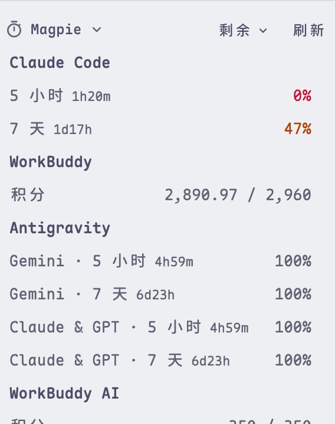
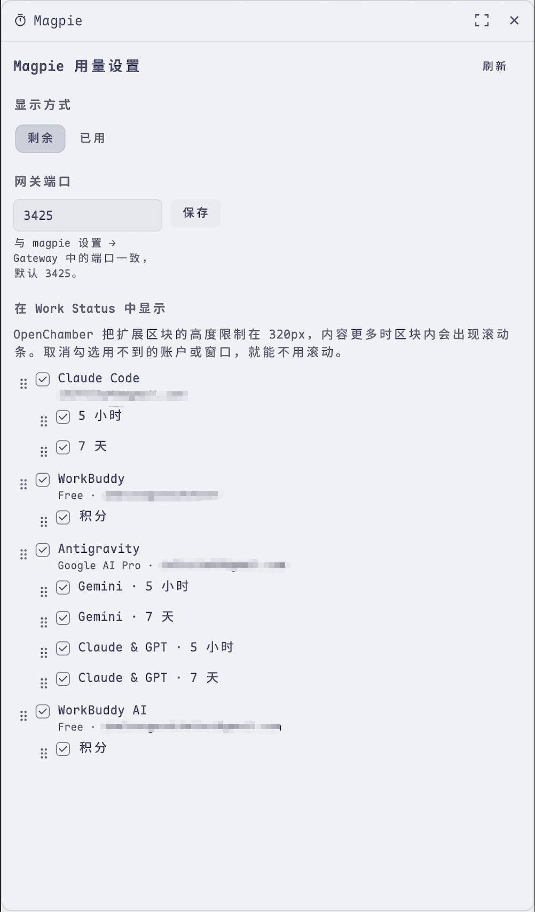

# Magpie · OpenChamber 扩展

在 OpenChamber 会话旁的 Work Status 面板里，用纯文字显示 [magpie](https://usemagpie.ai) 管理的订阅、编程套餐和 API Key 还剩多少用量，样式参照 OpenChamber 自带的"用量"区块。

| 用量（中文） | 用量（英文） |
| --- | --- |
|  |  |

| 设置面板（中文） | 设置面板（英文） |
| --- | --- |
|  |  |

- 区块标题栏有"剩余 ▾"和"刷新"两项，顺序在面板里拖。
- 每个账户一个小标题，下面每行是一个用量窗口：窗口名、重置倒计时、右对齐的数值。已用达到 50% 时数值显示为琥珀色，达到 80% 时显示为红色，与自带区块一致。
- 重置时间写成紧凑的倒计时："2h7m"、"1d18h"、"5h"，鼠标悬停可看到具体的日期时间。
- 顺序由面板里的拖动决定；没拖动过时窗口按时长排，短的在前（5 小时在 7 天之前），共享额度池的窗口（如 Antigravity 的 Gemini、Claude & GPT）保持在一起。
- 按次数或积分计量的窗口显示具体数值：剩余模式为"剩余 / 总额"，已用模式为"已用 / 总额"，百分比放在鼠标悬停提示里。其余窗口显示百分比。
- 会话使用 magpie 提供的模型（如 `magpie/claude/claude-opus-5-5`）时，对应账户排在最前。
- 每 60 秒自动刷新，每轮对话结束后也会立即刷新。余额类账户把余额显示在小标题右侧；magpie 读不到的账户显示"读取失败"，鼠标悬停可看到原因。
- 勾选状态每 5 秒同步一次：在面板里改动后，区块最迟 5 秒后生效。
- 文字跟随 OpenChamber 的语言（中文 / 英文），颜色跟随主题。

## 面板

右侧栏的"Magpie"面板是设置面板（用量本身显示在会话旁的 Work Status 区块里）：

- **显示方式**：剩余 / 已用。
- **网关端口**：与 magpie 设置 → Gateway 中的端口一致。
- **在 Work Status 中显示**：逐个账户、逐个窗口的勾选框，并用左侧的把手拖动来调整顺序。

排序靠拖动完成：拖动账户可以调整账户之间的顺序，拖动窗口可以调整同一账户内窗口的顺序；区块会跟着变。没拖动过时，会话所用的账户排在最前，窗口则短的在前（5 小时在 7 天之前）。

OpenChamber 把扩展区块的高度限制在 320px，内容超出时区块内会出现滚动条（这是宿主的限制，扩展无法取消）。取消勾选不常看的账户或窗口，就能让区块不用滚动。勾选会保存下来，可在多台设备、多个窗口之间共用。

## 工作方式

扩展页面运行在沙箱 iframe 中，只能访问 HTTPS 地址，无法直接请求 magpie 的本地网关 `http://127.0.0.1:3425`。因此扩展自带一个本地 service（`service/main.js`）：

- 由 OpenChamber 用它自带的 Node 运行时启动，系统里不需要另装 Node；
- 只监听 `127.0.0.1`，只接受带 OpenChamber 令牌的请求；
- 只发送 `GET http://127.0.0.1:<端口>/v1/magpie/quotas` 这一种请求，不写任何文件。

如果 magpie 暂时连不上，区块会继续显示上一次读到的数据，并注明读取时间。

## 安装

需要 OpenChamber 2.3.0 或更高版本（Web 或桌面版），并且 magpie 正在运行。

1. 打开 OpenChamber → **设置 → 扩展**。
2. 粘贴本文件夹的绝对路径，点击添加。
3. 授权对话框会提示这个扩展要运行"本地服务"，选择允许。OpenChamber 会提醒本地服务拥有完整的用户权限；这是所有本地服务都会出现的通用提示，本扩展的 service 只做上面列出的只读请求。
4. 会话旁的 Work Status 面板中会出现"Magpie"区块，可在该面板的区块列表里隐藏或调整位置。

如果你在 magpie 设置 → Gateway 中改过网关端口，区块会提示"连不上 magpie"，并在提示里给出端口输入框，填入正确的端口后保存即可。

## 开发

```sh
npm install
npm run build     # 生成 panel/main.js、status/main.js 和 service/main.js
npm run check     # 类型检查 + 用 SDK 自带的 schema 校验 manifest + 测试
```

OpenChamber 不会替扩展编译代码，所以构建产物需要和源码一起保存。以文件夹方式安装时，改完代码执行 `npm run build`，再在 设置 → 扩展 中重新加载即可。

## 目录结构

```
package.json          manifest（openchamber 字段）与脚本
panel/                设置面板：index.html + 构建出的 main.js
status/               Work Status 区块：index.html + 构建出的 main.js
service/main.js       构建出的本地 service
src/
  panel/main.ts       设置面板：显示方式、端口、勾选与拖动排序
  status/main.ts      Work Status 区块
  service/main.ts     本地 service：读取 magpie 网关
  shared/             数据规整、轮询与设置、中英文文案、行内容
scripts/              构建与 manifest 校验
test/                 单元测试与 service 测试
pics/                 截图
```
